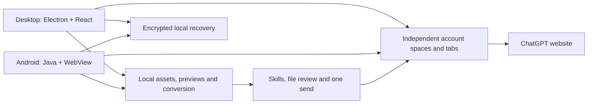

<div align="center">
  
  <h1>ChatGPT Studio</h1>
  <p>Independent accounts. Immersive browsing. Local asset workflows.</p>
  <p><a href="README.md">简体中文</a> · <strong>English</strong></p>
  <p>
    <a href="https://github.com/ForceMind/ChatGPT/releases/tag/v3.0.0-alpha.19"></a>
    <a href="https://github.com/ForceMind/ChatGPT/actions/workflows/android.yml"></a>
    
    
    
  </p>
  <p><a href="https://chatgpt-studio.pages.dev/">Website</a> · <a href="#download-and-install">Download</a> · <a href="#getting-started">Guide</a> · <a href="#technical-direction-and-architecture">Architecture</a> · <a href="#roadmap">Roadmap</a> · <a href="https://github.com/ForceMind/ChatGPT/issues">Issues</a></p>
</div>

ChatGPT Studio brings independent ChatGPT account spaces, tabs, downloaded assets, previews, conversions and reviewed file tasks into one application. Launch directly into the website with a white, gray and black interface and no address bar. Each device signs in independently; no OpenAI API key is required.

> Previously named **ChatGPT Profiles**. The current public prereleases are **3.0.0-alpha.20** for macOS, **3.0.0-alpha.18** for Windows and **3.0.0-alpha.19** for Android. Platforms update independently. Legacy filenames, internal identifiers and data locations are retained for upgrade compatibility.


## Features

- **Account spaces:** separate cookies, website storage and sign-in state, with names, email notes and small color markers.
- **Tabs:** create, pin, reorder, close and restore tabs per account. Android includes phone/tablet card views, filtering, search and renaming. Desktop does not proactively freeze or discard open pages.
- **Local asset library:** account ownership, imports and downloads, categories, search, favorites, tags, derived files and a recoverable trash.
- **Preview and conversion:** images, PDF, HTML, Markdown, text, CSV and supported media. Specialized formats can open in associated system applications. Conversions create new files and preserve originals.
- **Reviewed tasks:** select files, a target account and a Skill, then follow preparation, upload, instruction entry, readiness, a single send and confirmation. An uncertain result is not retried automatically.
- **Capabilities:** 120 project-authored task Skills with instructions, steps, deliverables and checks. The agent-library entry exists; it currently has no preset roles.
- **Local recovery:** saved account/tab state, drafts and reading positions. macOS also provides encrypted read-only conversation snapshots and confirmed updates.

This is an independently maintained, unofficial client. It does not include a ChatGPT subscription. Models and website features depend on the signed-in account and the ChatGPT service. Browser-space isolation does not provide a network proxy or complete fingerprint isolation.

## Technical direction and architecture

| Layer | Current implementation | Design choice |
| --- | --- | --- |
| Desktop | Electron 44, React 19, TypeScript, esbuild | Shared macOS/Windows implementation; website content is isolated from local management interfaces |
| Android | Java 17, AndroidX WebKit, System WebView | Preserve existing sign-in spaces; require runtime multi-profile support |
| Assets | Local files, constrained HTML/media previews, PDF and data conversion | Keep processing and derived copies on the device; review account, files and instructions before sending |
| Recovery | Platform encryption and account/storage/tab-bound records | Preserve existing website drafts and avoid duplicate sends |
| Delivery | GitHub Actions, GitHub Releases, Cloudflare Pages | Traceable builds, checksums and static website deployments |



Devices do not synchronize sign-in credentials. Alternative Android engines remain separate experiments and do not replace existing daily-use spaces. iPhone/iPad, proxy support and delta updates remain in the roadmap.

## Download and install

| Platform | Version | Downloads | Requirements |
| --- | --- | --- | --- |
| macOS · Apple Silicon | 3.0.0-alpha.20 | [DMG](https://github.com/ForceMind/ChatGPT/releases/download/v3.0.0-alpha.20/ChatGPT-Studio-3.0.0-alpha.20-mac-arm64.dmg) · [ZIP](https://github.com/ForceMind/ChatGPT/releases/download/v3.0.0-alpha.20/ChatGPT-Studio-3.0.0-alpha.20-mac-arm64.zip) | macOS 13+ |
| Windows · x64 | 3.0.0-alpha.18 | [EXE](https://github.com/ForceMind/ChatGPT/releases/download/v3.0.0-alpha.18/ChatGPT-Profiles-3.0.0-alpha.18-windows-x64-setup.exe) · [Portable ZIP](https://github.com/ForceMind/ChatGPT/releases/download/v3.0.0-alpha.18/ChatGPT-Profiles-3.0.0-alpha.18-windows-x64.zip) | Windows 10/11, 64-bit |
| Android · Phone/tablet | 3.0.0-alpha.19 | [APK](https://github.com/ForceMind/ChatGPT/releases/download/v3.0.0-alpha.19/ChatGPT-Studio-3.0.0-alpha.19-android.apk) | Android 9+, WebView with multi-profile support |

**macOS:** open the DMG and drag the app into Applications. Current packages are ad-hoc signed and not notarized. If macOS blocks the first launch, verify the source/checksum and consult [Apple's installation guidance](https://support.apple.com/en-us/102445).

**Windows:** run the EXE or extract the ZIP. The executable keeps its compatibility name, `ChatGPT Profiles.exe`. Both variants use the current user's data directory. Authenticode signing is not configured.

**Android:** allow installation from your chosen download source when prompted. Updates retain the existing release certificate. If the installed WebView lacks multi-profile support, update System WebView/Chrome first; the app does not substitute a shared sign-in space.

The [website](https://chatgpt-studio.pages.dev/) provides GitHub downloads and optional third-party acceleration links. Compare downloads with `SHA256SUMS.txt` in the Release. The current version is a **prerelease**; stable-only tools may report no Latest release. The version badge above includes prereleases, and the table links directly to the published assets.

### Android alpha.19

This update only makes tab terminology consistent. Account controls, layout, navigation, the original ChatGPT webpage and runtime behavior are retained from alpha.18. Tab counts, management, search, new tabs, pinning, renaming and closing now use tab labels. See the [Android build/native verification record](docs/releases/3.0.0-alpha.19-android.json).

### Desktop alpha.18

App-owned desktop UI now uses clearer type and contrast, with 15px body text, 14px supporting text and a 13px label floor. Narrow windows use a details drawer. The macOS menu bar icon is restored for window, account, workbench and update actions.

Android opens directly into the webpage with account, tabs and more controls. A searchable tab sheet supports pinning, renaming, sorting, closing and restoring recent tabs. Browser-style bottom controls and developer diagnostics are removed from normal menus. Foreground switches reuse the original webpage, draft, scroll and generation context without a background service. Window recreation reuses pages; process termination requires reloading before restoring saved drafts and positions. See the [macOS alpha.20 release manifest](docs/releases/3.0.0-alpha.20.json), [Windows alpha.18 manifest](docs/releases/3.0.0-alpha.18.json) and [Android alpha.19 record](docs/releases/3.0.0-alpha.19-android.json) for exact binaries, sources and signatures.

macOS checks for updates at launch and at noon in Shanghai time. After confirmation it downloads and verifies a complete ZIP. Installation can run immediately, on exit or after the app has been idle under the configured safeguards. Native application updates require a restart; delta updates are not implemented. Windows and Android currently update manually.

## Getting started

1. Launch the app and sign in to ChatGPT in the default account space.
2. Add another space from the account menu; set its name and optional email note. Desktop also provides language and timezone choices.
3. Sign in independently in that space and verify the identity shown by the website.
4. Create tabs with the plus button. On Android, tap the tab count for the card overview.
5. Use Assets and Skills to select files and processing instructions. Confirm the destination account before a task starts; cross-account attachments require explicit consent.

Account notes do not replace the website's sign-in identity. “Sent” means the website displayed the user message, not that the model completed processing. Check the target conversation after an interruption or an uncertain result.

On Android, open **More → 保活与诊断** to enable background tasks, inspect Android/WebView versions and network/reload events, or stop the mode. It increases power use. OS sleep, vendor restrictions, forced stops and network/service conditions can still interrupt work; recovery does not resend messages automatically.

Closing a macOS window retains pages in the background. A full process exit requires reloading, then restoring saved state. Existing website drafts take precedence. Uploads and model generation do not continue across a terminated local browser process.

## Platform support

| Capability | macOS | Windows | Android |
| --- | --- | --- | --- |
| Multiple accounts, independent storage and tabs | Available | Available | Available |
| Local asset library and previews | Available | Available | Available; static HTML/SVG previews |
| Image, document and data conversion | Available | Available | Available, with platform-specific limits |
| Skills and file tasks | Available | Available | Available; real-service acceptance pending |
| Draft and reading-position recovery | Available | Available | Available |
| Encrypted conversation snapshots/offline reading | Available | Planned | Planned |
| Confirmed download and exit/idle installation | Available | Planned | Planned |
| Per-account language/timezone | Available | Available | Separate PoC; not in the regular APK |

Conversion options include PNG/JPEG/WebP, SVG rasterization, HTML/Markdown to PDF, selected PDF pages to images, and CSV/JSON conversion. Details and limits are documented in the [desktop](desktop/README.md) and [Android](android/README.md) guides.

Website images support copying original pixels, saving to the asset library, retrying loads and inspecting load information on desktop. Actual generation/download speed depends on the service and network. A system/Chrome passkey chooser is not integrated. Touch ID recovery protection requires a suitable Developer ID signature and is unavailable in the current ad-hoc package.

## Data and upgrade compatibility

| Platform | Existing data location |
| --- | --- |
| macOS | `~/Library/Application Support/ChatGPT Profiles/` |
| Windows, installed or ZIP | `%APPDATA%\ChatGPT Profiles\` |
| Android | Existing app-private directory; package identity is unchanged |

The rename does not migrate or delete these data directories. macOS alpha.20 uses ChatGPT Studio for its app bundle, system name and executable. Older updaters receive a dedicated ChatGPT-Profiles ZIP; its first launch verifies the signature and moves to the sibling ChatGPT Studio.app without replacing another installation. Internal application identifiers, the internal storage name, Windows executable name and encryption identity remain compatible. Normal upgrades do not require uninstalling or clearing account data.

Desktop state is stored in `state.json`, browser spaces in `Partitions/profile-UUID`, and assets/tasks/recovery records under the same data root. To back up desktop data, fully exit before copying the entire directory. Android uninstalling removes its local spaces.

Web pages are sandboxed without Node or local administration interfaces. HTML previews use a constrained environment; drafts and recovery records use platform encryption. The app does not collect account passwords or synchronize spaces to a self-hosted account service. Clearing a local space does not delete cloud conversations.

## Validation and resource use

| Platform | Current acceptance |
| --- | --- |
| macOS | 63 unit checks, 24 applicable interface flows, complete ZIP installation and native recovery checks |
| Windows | 62 applicable unit checks, 14 applicable interface flows, installation/normal exit/uninstall with account data retained |
| Android | 66 unit checks, 4 phone and 4 tablet flows; three accounts/eight pages for 330 seconds, lock/Doze/network recovery and a real process restart |

The Android matrix covers actual stock OS/WebView combinations from API28 through API36. Compatible providers on Android 12L, 15 and 16 passed the full lifecycle flow. Six older stock providers only passed the required update-message check; they are not retention successes. OS version alone does not determine support. See the [alpha.17 system compatibility record](docs/releases/3.0.0-alpha.17-native-ci.json). Current native UI and foreground checks are listed in the [alpha.18 CI index](docs/releases/3.0.0-alpha.18-ci.json).

For the eight-page synthetic workload, final background PSS totals were about **234–284 MiB**. Three short CPU samples per group ranged from **1.9–5.8% of one core**. These include app processes, WebView sandboxes and debug transport overhead, and are not real ChatGPT or physical-device measurements.

Historical macOS alpha.14 measurements for three accounts/eight tabs were approximately 1.08 GiB working set/2.70% CPU for lightweight pages, and 1.47 GiB/1.72% for long conversation/image fixtures. Shared pages are included in those working sets. Different payloads and metrics are not directly comparable.

[Android raw matrix/resources](docs/benchmarks/android-alpha17-native-lifecycle.json) · [Historical Mac regression](docs/benchmarks/macos-alpha14-regression-20261024.json) · [Historical Mac resources](docs/benchmarks/macos-alpha14-resources-20261024.json) · [Development record](MACOS_MIGRATION_PLAN.md)

## Development and delivery

```text
desktop/       Electron + React + TypeScript
android/       Java + AndroidX WebKit
site/          Canonical static website and update feed
site-legacy/   Legacy redirects; export the feed from site/ at deployment
docs/          Screenshots, verification and release records
.github/       Platform checks and packaging workflows
```

Desktop uses Node.js 26.7.0. Android uses JDK 17, SDK Platform 36 and Build Tools 35.0.0. Tests use isolated temporary data and loopback fixtures rather than personal accounts.

```sh
cd desktop
npm ci
npm start
npm run check
npm run test:e2e
```

```sh
cd android
./gradlew testDebugUnitTest lintDebug assembleDebug
./gradlew -Pandroid.testInstrumentationRunnerArguments.fixtureMode=true connectedDebugAndroidTest
```

Use a disposable emulator for fixture tests. Installers are built in **GitHub Actions**. `macos-validation.yml` handles desktop regression/resources; `macos-release.yml`, `windows.yml` and `android.yml` validate and package their platforms. Android signing material stays in protected local configuration and is not committed.

Cloudflare Pages uses Direct Upload; a Git push does not deploy the site automatically. Deploy `site/` to `chatgpt-studio`. For the old `chatgpt-profiles` project, combine `site-legacy/_redirects` with canonical `_headers`, and export `site/updates/macos.json` as the legacy site's `compat/macos.json` from the same commit. There is one source for the feed. Legacy pages permanently redirect; the old Mac update JSON URL remains a direct response for installed clients.

## Roadmap

| Area | Status |
| --- | --- |
| Real macOS account upload/first-message/single-send acceptance | Deferred manual acceptance; isolated flows pass |
| Android real homepage, accounts, voice/files and vendor devices | Deferred manual acceptance; website images are labeled native fixtures |
| Android alpha.19 tab terminology | Published; layout/runtime retained; [publication/online record](docs/releases/3.0.0-alpha.19-publication.json) |
| macOS alpha.20 complete Studio naming and legacy updater compatibility | App bundle, OS name and manual downloads use Studio; existing account and encryption identities retained. [Release record](docs/releases/3.0.0-alpha.20.json) |
| Alpha.18 installers, immersive Android, readable UI and macOS menu bar | Published; [publication/online record](docs/releases/3.0.0-alpha.18-publication.json) |
| Windows offline snapshots/auto-updates; complete Android offline snapshots | Future batch |
| Android per-account locale/timezone engine migration | Separate PoC; regular engine is unchanged |
| System/Chrome passkeys, signed Touch ID and stable signing | Not integrated or dependent on unavailable certificates/device acceptance |
| Project-authored agent presets | Entry exists; current preset count is zero |
| In-app proxy/VLESS | Planning only; no free nodes supplied |
| iPhone/iPad, Intel Mac, Linux and store distribution | Outside the current iteration; no packages |
| Delta updates | Not implemented; native updates require restart |

## FAQ

**Why can a page reload after closing the application?** A retained window/tab differs from a terminated browser process. After termination, the app reloads and restores saved drafts/positions. It does not resume uploads or resend messages automatically.

**How do I keep Android tasks running?** Enable the notification-backed mode in More → 保活与诊断. Open pages run while Studio is foreground. The mode can be stopped, consumes additional power, and remains subject to OS/vendor/network limits.

**Why does an HTML or specialized file still need resources or another app?** HTML is offline by default and may opt into HTTPS resources per file. Unimported local dependencies are not automatically accessible. Office/archive/unsupported formats need an installed system handler; originals and Save As remain available.

## Feedback and contributions

Open a [GitHub issue](https://github.com/ForceMind/ChatGPT/issues) with the platform, app/WebView version, reproduction steps, expected result and actual result. Redact personal information. Do not submit passwords, verification codes, cookies, download tokens or account directories.

Follow repository working agreements and run checks relevant to your change. Distinguish fixtures, emulators, physical devices and real-service acceptance in code and documentation.

## License and trademarks

Project-owned code uses the [ChatGPT Studio Noncommercial Source License v1.0](LICENSE). Noncommercial use, modification and source/binary redistribution are permitted under its conditions. Commercial use requires prior explicit written authorization; **internal business/office use also requires authorization**. Contact [me@xincreates.com](mailto:me@xincreates.com). This is a custom source-available, noncommercial license, not MIT/Apache/GPL or an OSI open-source license. The Chinese license text is authoritative; it has not undergone professional legal review.

Dependencies and icons retain their own licenses and rights notices. The project license does not relicense them or grant OpenAI/ChatGPT trademark, account or service rights. This project is not affiliated with OpenAI.
