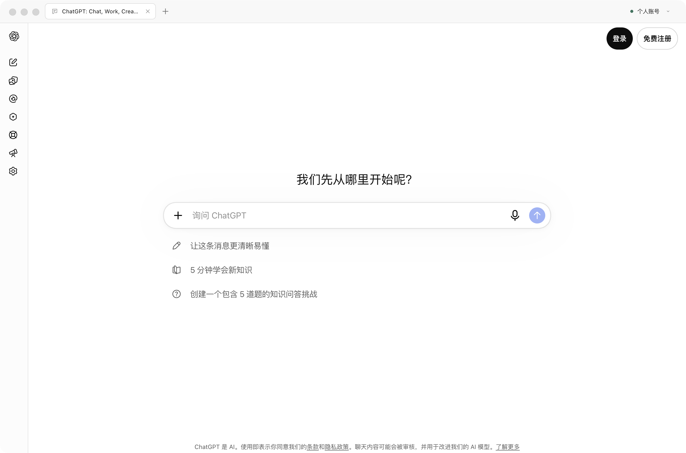
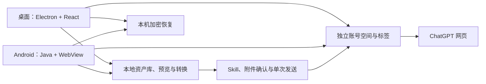

  
  <h1>ChatGPT Studio</h1>
  
独立账号空间 · 沉浸式网页 · 本地文件工作流

  
<strong>简体中文</strong> · <a href="README.en.md">English</a>

  

    
    
    
    
    
  

  
<a href="https://chatgpt-studio.pages.dev/">官网</a> · <a href="#下载与安装">下载</a> · <a href="#开始使用">使用指南</a> · <a href="#技术方向与架构">技术架构</a> · <a href="#路线图与待完成事项">路线图</a> · <a href="https://github.com/ForceMind/ChatGPT/issues">问题反馈</a>

**沉浸式多账号 ChatGPT 工作台。**

在独立账号空间中使用 ChatGPT，管理标签与会话，把下载、预览、格式转换和文件处理集中在一个应用里。启动直接进入网页，采用白灰黑界面，没有地址栏；各设备独立登录，无需配置 OpenAI API Key。

> 项目已从 ChatGPT Profiles 更名为 **ChatGPT Studio**。当前 macOS 公开版为 **3.0.0-alpha.20**，Windows 为 **3.0.0-alpha.18**，Android 为 **3.0.0-alpha.19**；各平台按下表独立更新。历史文件名、应用标识和数据目录保留，用于兼容既有登录、加密记录与更新流程。

**开发候选 alpha.21** 加入自有角色、设计补丁 Skill，以及 Windows 更新与加密离线快照。安装包与验证范围见[桌面候选收据](docs/releases/3.0.0-alpha.21-desktop-candidate.json)；尚未替换下表的公开下载或已安装版本。

## 产品能力

- **账号空间**：独立 Cookie、网站存储和登录状态；账号名称、邮箱备注与色点帮助区分空间。
- **标签管理**：按账号切换、新建、固定、排序、关闭与恢复。桌面端不主动冻结或丢弃已打开标签；Android 提供手机 / 平板卡片总览、窗口重建保留与可选后台任务模式。
- **资产工作台**：按账号归档下载与导入文件，支持搜索、分类、收藏、标签、派生关系和可恢复回收站。
- **预览与转换**：查看图片、PDF、HTML、Markdown、文本、CSV 及支持的音视频；更多专用格式可交给系统应用。转换生成新副本，保留原文件。
- **任务流**：选择文件、目标账号与 Skill，通过网页发起处理任务；保留进度、失败位置及结果不确定状态，不自动重复发送。
- **能力库**：公开版内置 120 个项目任务 Skill，包含步骤、交付结构与质量检查；alpha.21 桌面候选扩展为 121 个 Skill、32 个自有角色，其中 24 个互联网相关角色优先展示。
- **本地恢复**：保存账号、标签、草稿、阅读位置与工作台状态；macOS 另提供加密的只读对话快照及确认更新。

ChatGPT Studio 是独立维护的非官方客户端，不附带 ChatGPT 订阅权益。模型和网页功能由当前登录账号及 ChatGPT 服务决定；浏览器空间隔离不等于网络代理或完整指纹隔离。

## 技术方向与架构

| 层次 | 当前方案 | 设计取舍 |
| --- | --- | --- |
| 桌面客户端 | Electron 44、React 19、TypeScript、esbuild | macOS / Windows 共用桌面实现，网页与本地管理界面隔离 |
| Android 客户端 | Java 17、AndroidX WebKit、System WebView | 使用系统兼容内核，保留现有账号登录空间，按实际能力启用多档案 |
| 文件工作流 | 本机文件、受限 HTML / 媒体预览、PDF 与数据转换 | 处理与派生副本留在本机；发给 GPT 前明确选择账号、附件和指令 |
| 状态与恢复 | 平台加密、账号 / 存储空间 / 标签绑定的记录 | 不覆盖网页已有草稿，不重发结果不明的消息 |
| 发布与站点 | GitHub Actions、GitHub Releases、Cloudflare Pages | 构建、校验与公开下载可追溯；站点以静态文件部署 |

各设备独立使用，不同步登录凭据。Android 的其他浏览器内核仍属于独立实验；迁移方案验证前不替换日常客户端的现有空间。iPhone/iPad、代理与差量更新的状态见路线图。

## 下载与安装

### 公开预发布版

| 平台 | 版本 | 下载 | 要求 |
| --- | --- | --- | --- |
| macOS · Apple Silicon | 3.0.0-alpha.20 | [DMG](https://github.com/ForceMind/ChatGPT/releases/download/v3.0.0-alpha.20/ChatGPT-Studio-3.0.0-alpha.20-mac-arm64.dmg) · [ZIP](https://github.com/ForceMind/ChatGPT/releases/download/v3.0.0-alpha.20/ChatGPT-Studio-3.0.0-alpha.20-mac-arm64.zip) | macOS 13+ |
| Windows · x64 | 3.0.0-alpha.18 | [EXE](https://github.com/ForceMind/ChatGPT/releases/download/v3.0.0-alpha.18/ChatGPT-Profiles-3.0.0-alpha.18-windows-x64-setup.exe) · [免安装 ZIP](https://github.com/ForceMind/ChatGPT/releases/download/v3.0.0-alpha.18/ChatGPT-Profiles-3.0.0-alpha.18-windows-x64.zip) | Windows 10 / 11 · 64 位 |
| Android · 手机 / 平板 | 3.0.0-alpha.19 | [APK](https://github.com/ForceMind/ChatGPT/releases/download/v3.0.0-alpha.19/ChatGPT-Studio-3.0.0-alpha.19-android.apk) | Android 9+，WebView 支持多档案 |

**macOS**：打开 DMG，将应用拖入“应用程序”。当前为 ad-hoc 签名，尚未经过 Apple 公证；首次启动被系统阻止时，核对来源和摘要后参阅 [Apple 安装说明](https://support.apple.com/zh-cn/102445)。

**Windows**：运行 EXE 安装，或解压 ZIP 后启动应用。程序文件名保留为 ChatGPT Profiles.exe；免安装版同样使用当前用户的数据目录。当前未配置 Authenticode 签名。

**Android**：按系统提示允许该下载来源安装；升级时沿用同一应用签名。WebView 不支持多档案时应先更新系统 WebView / Chrome，应用不会退回共享登录空间。

[官网](https://chatgpt-studio.pages.dev/)提供原始 GitHub 下载和可选国内加速入口。第三方加速不可用时可改用原始链接；下载后可与对应 Release 的 SHA256SUMS.txt 核对。

Android 的 Studio 文件名对应 [SHA256SUMS-studio.txt](https://github.com/ForceMind/ChatGPT/releases/download/v3.0.0-alpha.19/SHA256SUMS-studio.txt)；旧文件名及原校验清单保留，包内容与签名相同。

当前版本标记为 **Pre-release**，公开发布包含安装包和校验清单。只查询稳定版的工具可能显示没有 Latest 版本；本页版本徽章包含预发布，下载表直接指向带附件的 Release。

### 版本与升级

**Android alpha.19** 仅统一标签管理文案，沿用 alpha.18 的现有布局、入口和功能。顶部计数、管理面板、搜索、新建、固定、重命名和关闭使用“标签页”；ChatGPT 原网页与云端对话保持原样。[Android 构建与原生验证记录](docs/releases/3.0.0-alpha.19-android.json)。

**桌面 alpha.18** 统一 App 自有界面的字号与对比度：正文 15、辅助 14、标签至少 13，窄窗详情使用抽屉，文件操作保留清晰入口；恢复 macOS 顶部菜单栏图标，支持显示窗口、切换账号、打开资产 / 能力库和检查更新。

Android 默认进入网页，顶部仅保留账号、标签和更多；按需展开可搜索的标签清单，支持重命名、固定、排序、关闭和最近关闭恢复。主页移除浏览器式底栏，普通菜单移除开发诊断。App 前台切换已载入页面会复用同一网页、草稿、滚动和生成上下文，无需开启后台服务；窗口重建保留原页面，进程终止后需加载一次再恢复已保存草稿与阅读位置。Mac 安装包、兼容更新与签名见[alpha.20 发布索引](docs/releases/3.0.0-alpha.20.json)，Windows 见[alpha.18 发布索引](docs/releases/3.0.0-alpha.18.json)，Android 见[alpha.19 记录](docs/releases/3.0.0-alpha.19-android.json)。

Mac 从 alpha.12 起支持启动与每天上海时间 12:00 检查更新，确认后后台下载、校验完整 ZIP，可选择立即、下次退出或应用空闲时安装。原生程序更新需要重启，暂不支持增量更新；Windows / Android 当前手动升级。

## 开始使用

1. 打开应用，在默认“个人账号”空间中登录 ChatGPT。
2. 从账号菜单添加空间，填写名称、可选邮箱备注；桌面端还可选择语言和时区。
3. 在新空间中登录对应账号，核对网页身份后，通过账号菜单切换。
4. 点击加号建立当前账号的标签，使用“资产”和“能力库”整理文件与任务。
5. 将文件交给 GPT 前核对目标账号；跨账号使用文件需要明确确认。

账号备注不会替代网页登录身份。任务显示“已发送”表示网页已出现本次用户消息，不代表模型已完成处理；应用中断或发送结果未知时，请先检查目标对话。

macOS 关闭窗口后保留后台页面。真正退出后，应用重新加载网页，再恢复已保存的草稿和阅读位置；网页已有草稿时保留网页版本。附件上传和模型生成不会跨进程继续。

Android 点击底部标签数量打开总览。“更多 → 保活与诊断”可开启后台任务、查看当前 Android / WebView、网络与重载记录，并随时停止。模式会增加耗电；锁屏休眠、厂商省电、强制停止与网络服务仍可能中断运行，应用不会因此自动重发消息。

## 平台支持

| 能力 | macOS | Windows | Android |
| --- | --- | --- | --- |
| 多账号、独立存储、标签管理 | 支持 | 支持 | 支持 |
| 账号资产库与本地预览 | 支持 | 支持 | 支持，HTML / SVG 静态预览 |
| 图片、文档与数据转换 | 支持 | 支持 | 支持，范围见移动端说明 |
| Skill 与带文件任务 | 支持 | 支持 | 支持，实站兼容仍待验收 |
| 草稿与阅读位置恢复 | 支持 | 支持 | 支持 |
| 加密对话快照、离线阅读 | 已公开 | 后续 | 后续 |
| 确认下载与退出 / 空闲安装 | 已公开 | 后续 | 后续 |
| 每账号语言 / 时区选择 | 支持 | 支持 | 独立 PoC，尚未迁入普通 APK |

图片支持 PNG / JPEG / WebP、SVG 转图片；文档支持 HTML / Markdown 导出 PDF、PDF 选页转图片；数据支持 CSV 与 JSON 互转。具体选项和格式差异见[桌面说明](desktop/README.md)与[Android 说明](android/README.md)。

网页图片可右键复制原始像素、保存到资产库、重试加载并查看加载信息。实际出图速度仍取决于网站、网络与图片服务。现有系统 / Chrome 通行密钥选择器尚未接入；Touch ID 恢复保护需要 Developer ID 签名，当前临时签名包不能启用。

## 数据与升级兼容

| 平台 | 当前数据位置 |
| --- | --- |
| macOS | ~/Library/Application Support/ChatGPT Profiles/ |
| Windows · EXE / ZIP | %APPDATA%\ChatGPT Profiles\ |
| Android | 原应用私有目录，包名保持不变 |

更名不迁移或删除这些数据目录。macOS alpha.20 的应用文件、系统名称与可执行文件统一为 ChatGPT Studio；旧版自动更新仍使用专用的 ChatGPT-Profiles ZIP，首次启动时校验签名并迁移到同级 ChatGPT Studio.app，不覆盖已有同名应用。内部应用名、应用标识、Windows 可执行文件名与既有加密身份保留为兼容标识。常规升级无需卸载或清理账号数据。

账号与标签位于 state.json，浏览器数据位于 Partitions/profile-UUID，资产、任务和恢复记录保存在同一数据根目录。备份时应在应用真正退出后复制整个目录；Android 卸载会删除对应的本机空间。

网页使用沙箱和上下文隔离，不具有 Node 或本地管理接口权限。HTML 预览在独立受限环境中运行；对话草稿与恢复记录通过系统加密保护。应用不收集账号密码，也不将登录空间同步到自建服务。账号清除不会删除 ChatGPT 云端对话。

## 验证与资源占用

本版使用 GitHub Actions 和独立临时数据验证：

| 平台 | 本轮检查 |
| --- | --- |
| macOS | 63 项单元、24 项适用界面流程，完整 ZIP 安装与恢复组件校验 |
| Windows | 62 项适用单元、14 项适用界面流程，安装 / 退出 / 卸载保留数据 |
| Android | 66 项单元、手机 4 / 平板 4 项原生流程；兼容内核下 3 账号 / 8 页运行 330 秒、锁屏 / Doze / 断网后返回及实际进程重启恢复 |

Android 矩阵覆盖 API28–36 的实际预装 WebView 组合。Android 12L / 15 / 16 的兼容内核通过完整流程；六组旧预装内核只验证“不支持多档案时提示更新”，不计为保活通过。系统版本与 WebView 版本须一起判断，详细条件见 [alpha.17 系统兼容记录](docs/releases/3.0.0-alpha.17-native-ci.json)；alpha.18 的新界面与前台复用见[alpha.18 验收索引](docs/releases/3.0.0-alpha.18-ci.json)。

8 页合成负载的模拟器后台末段 PSS 合计约 **234–284 MiB**，各组 3 个短 CPU 样本的范围约 **1.9–5.8% 单核**。包含应用、WebView 沙箱渲染器和调试流负载，不能替代真实 ChatGPT 或实机测量，也不能与不同负载的桌面数据直接比较。

以下为历史 alpha.14 macOS 合成负载，3 账号、8 标签隐藏约 331 秒后的资源记录：

| 模拟负载 · 8 标签 | 工作集合计 | 空闲 CPU 合计 |
| --- | --- | --- |
| 轻量页面 | 约 1.08 GiB | 约 2.70% |
| 长对话与图片 | 约 1.47 GiB | 约 1.72% |

桌面数据来自同一台 CI 主机上的本地模拟页面，工作集包含共享页；不能视为实际 ChatGPT 的占用上限或统计性性能保证。真实账号、个人升级与厂商真机验收单独记录。

[Android 原始矩阵与资源](docs/benchmarks/android-alpha17-native-lifecycle.json) · [历史 Mac 回归](docs/benchmarks/macos-alpha14-regression-20261024.json) · [历史 Mac 资源](docs/benchmarks/macos-alpha14-resources-20261024.json) · [完整开发与交付记录](MACOS_MIGRATION_PLAN.md)

## 开发与交付

~~~text
desktop/       Electron + React + TypeScript 桌面客户端
android/       Java + AndroidX WebKit 移动客户端
site/          静态下载主页与使用说明
site-legacy/   旧站跳转规则；更新清单由 site/ 同源导出
docs/          截图、验证与发布索引
.github/       平台验证和打包工作流
~~~

桌面端使用 Node.js 26.7.0；Android 使用 JDK 17、SDK Platform 36、Build Tools 35.0.0。开发测试使用回环网页和独立临时数据，不依赖个人账号。

~~~sh
cd desktop
npm ci
npm start
npm run check
npm run test:e2e
~~~

~~~sh
cd android
./gradlew testDebugUnitTest lintDebug assembleDebug
./gradlew -Pandroid.testInstrumentationRunnerArguments.fixtureMode=true connectedDebugAndroidTest
~~~

安装包由 **GitHub Actions** 构建。macos-validation.yml 执行独立回归与资源对照；macos-release.yml、windows.yml 和 android.yml 分别负责平台验证 / 打包。Android 发布签名材料保留在受保护的本地配置中，不提交仓库。

网站是无构建依赖的静态页面，Cloudflare Pages 采用 Direct Upload；Git 推送不会自动部署官网。`site/` 部署到 `chatgpt-studio` 项目。旧 `chatgpt-profiles` 项目使用 `site-legacy/_redirects`，部署时从同一提交复制主站的 `_headers`，并将 `site/updates/macos.json` 导出为旧站的 `compat/macos.json`，保持更新清单只有一个源码。

旧站页面永久跳转到新官网；已安装 Mac App 使用的旧 `/updates/macos.json` 继续直接返回 JSON。部署后分别检查新站、旧站跳转与无 Cookie 的兼容更新接口。源码、CI 候选、公开 Release 和线上版本分别记录，不覆盖历史包与校验摘要。

## 路线图与待完成事项

| 优先级 / 阶段 | 工作 | 当前状态 |
| --- | --- | --- |
| 待人工验收 | Mac 真实账号的附件上传、首条消息与一次发送 | 用户稍后验收；隔离回归已通过 |
| 待人工验收 | Android 实际首页、真实账号 / 登录、语音与文件流程 | 官网展示原生标签 / 平板 / 资产 / Skill 测试界面，实站另验 |
| 已发布 | Android alpha.19 最小文案统一 | 布局与功能沿用；[发布与线上记录](docs/releases/3.0.0-alpha.19-publication.json) |
| 已发布 | macOS alpha.20 完整更名与旧版兼容更新 | 应用、系统名称与手动下载统一 Studio，账号目录与加密身份保留；[发布记录](docs/releases/3.0.0-alpha.20.json) |
| 已发布 | alpha.18 三端包、沉浸式 Android、清晰字号与 Mac 菜单栏 | 下载、官网与 Mac 更新清单同步；[发布与线上验证记录](docs/releases/3.0.0-alpha.18-publication.json) |
| 开发候选 | Windows 加密离线快照、当前用户 EXE 更新，ZIP 校验与另存 | alpha.21 候选；[验证范围与包](docs/releases/3.0.0-alpha.21-desktop-candidate.json) |
| 平台迭代 | Android 完整离线快照 | 后续批次 |
| 环境隔离 | Android 每账号语言 / 时区从独立 PoC 迁入日常客户端 | 路线验证完成，尚未替换普通内核 |
| 系统集成 | 系统 / Chrome 通行密钥、真实 Touch ID 恢复与稳定签名 | 通行密钥未接入；Touch ID 受证书与实机验收条件限制 |
| 能力内容 | 自有智能体与设计补丁 Skill | alpha.21 桌面候选含 32 个角色，支持单独使用、组合 Skill、收藏与任务恢复；公开版预置角色仍为 0 |
| 移动网络 | 应用内代理与 VLESS 配置 | 方案阶段，未交付，不提供免费节点 |
| 新平台 | iPhone / iPad 后续开发；Intel Mac、Linux 与商店发行 | 未纳入当前迭代，暂无对应安装包 |
| 更新能力 | 差量下载与更细的更新体验 | 未实现；完整原生程序更新仍需重启 |

已完成的历史工作与每批验证边界保留在开发记录中；本表列的是当前缺口，不代表已开始全部后续开发。

## 常见问题

为什么关闭后仍可能重新加载网页？

窗口关闭、标签切换与进程退出是不同状态。保留的页面可继续使用；进程或渲染器被系统结束后，重新加载网页，再恢复已保存的草稿与阅读位置。附件上传和模型生成不会跨进程继续，恢复不会自动发送。

Android 如何在后台继续任务？

打开“更多 → 保活与诊断”，主动开启带常驻通知的后台模式。App 前台保持已打开页面执行；后台模式可随时停止，也会增加耗电。系统休眠、厂商限制和网络仍可能中断运行，可在同一入口查看原因。

HTML 或专用文件为什么仍依赖外部资源或系统应用？

HTML 默认离线，可为当前文件允许 HTTPS 资源；未导入的本地关联文件不会自动获得访问权。Office、压缩包和不支持的编码使用本机关联应用，应用未安装时可另存为；原文件保留。各平台支持范围见平台说明。

## 反馈与贡献

请通过 [GitHub Issues](https://github.com/ForceMind/ChatGPT/issues) 提供平台、应用 / WebView 版本、复现步骤、预期与实际结果。截图和日志请先遮盖个人信息，不要提交密码、验证码、Cookie、下载令牌或完整账号目录。

修改前请阅读仓库内的工作约定，并在对应平台运行相关检查。功能与文档应明确区分真实集成、隔离夹具、模拟器和实机证据。

## 许可与商标

自有代码采用[ChatGPT Studio 非商业源码许可 v1.0](LICENSE)：允许非商业使用、二次开发及源码 / 二进制分发；商业使用须事先取得明确书面授权，**企业内部办公同样属于商业使用**。联系 [me@xincreates.com](mailto:me@xincreates.com)。这是源码公开的非商业许可，不是 MIT / Apache / GPL 或 OSI 标准开源许可；定制文本尚未经过专业法律审查。

第三方依赖与图标继续遵循各自授权，项目许可不重新授予它们的权利。ChatGPT 与 OpenAI 的名称、图标及服务属于相应权利人，本项目与 OpenAI 无隶属关系。
