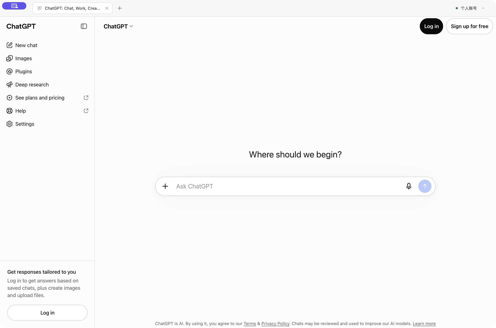
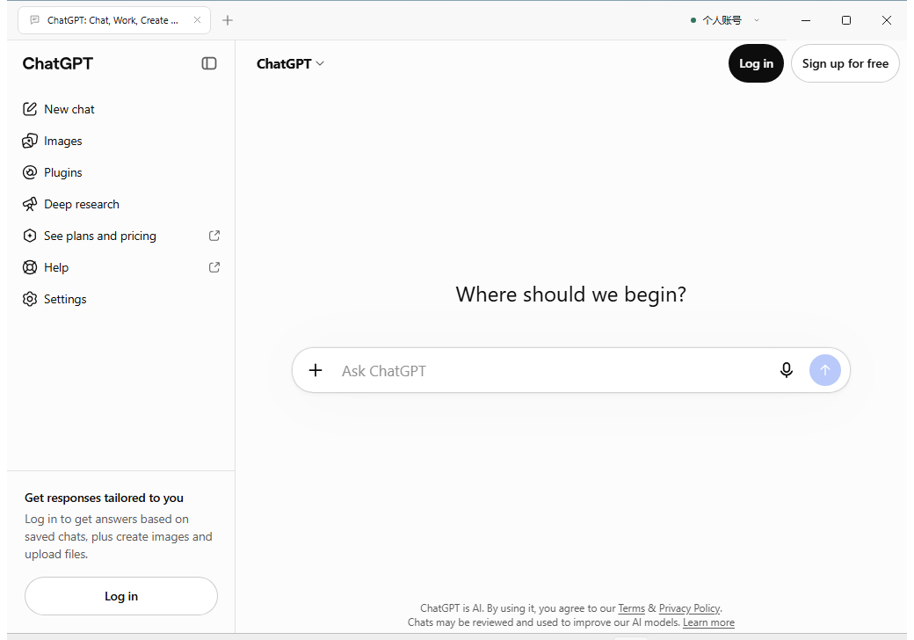
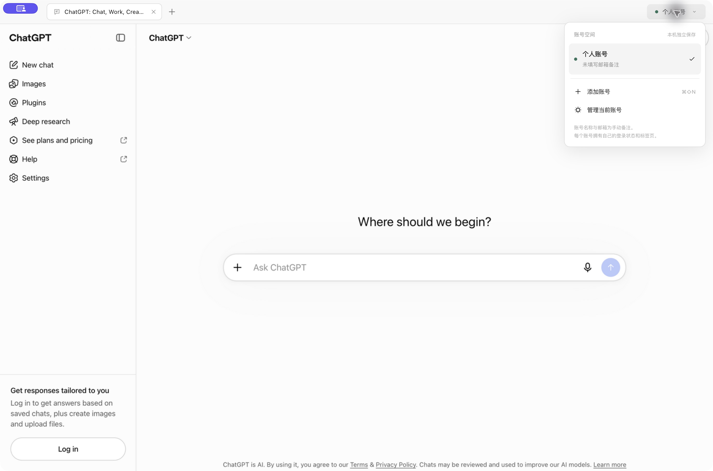
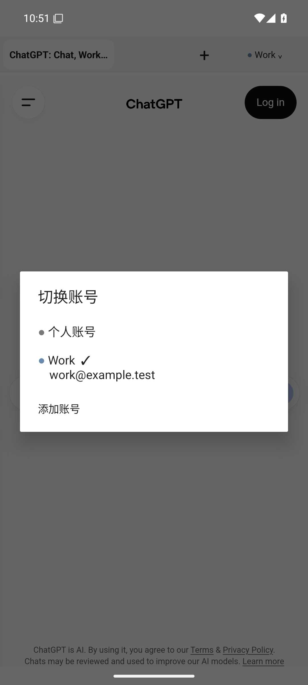

# ChatGPT Profiles

**打开即进入 ChatGPT，为不同账号保留独立的浏览器空间与标签页。**

ChatGPT Profiles 是一个非官方 ChatGPT 网页客户端。它保留网页本身的使用体验，在顶部增加轻量的账号与标签管理：白色、浅灰、黑色控件，没有地址栏，账号只用小色点辅助区分。

**[访问项目主页与下载](https://chatgpt-profiles.pages.dev/)** · [GitHub Releases](https://github.com/ForceMind/ChatGPT/releases) · [使用指南](#开始使用)

当前公开预发布版本：Windows x64 为 **3.0.0-alpha.2**，macOS 与 Android 为 **3.0.0-alpha.1**。真实账号登录与切换仍待人工验收，不能将存储隔离测试等同于所有登录方式都已通过。



当前功能分支正在交付 macOS `3.0.0-alpha.3` 本地体验版：账号资产库、安全预览、本地格式转换、网页任务发送、120 个 Skill、328 个智能体（232 个互联网候选优先），以及脱敏登录链接记录。使用与验证边界见 [桌面说明](desktop/README.md#macos-工作台--alpha3)。官网仍指向已公开版本，Windows / Android 的工作台迭代后续安排。

## 下载与安装

安装包从本仓库 [Releases](https://github.com/ForceMind/ChatGPT/releases) 获取。首个版本使用预发布渠道，便于在实际使用后继续修正。

| 平台 | 安装包 | 当前范围 |
| --- | --- | --- |
| macOS · Apple Silicon | [DMG](https://github.com/ForceMind/ChatGPT/releases/download/v3.0.0-alpha.1/ChatGPT-Profiles-3.0.0-alpha.1-mac-arm64.dmg) · [ZIP](https://github.com/ForceMind/ChatGPT/releases/download/v3.0.0-alpha.1/ChatGPT-Profiles-3.0.0-alpha.1-mac-arm64.zip) | macOS 13+，当前在 macOS 26.2 / ARM64 验证 |
| Android · 手机 / 平板 | [APK](https://github.com/ForceMind/ChatGPT/releases/download/v3.0.0-alpha.1/ChatGPT-Profiles-3.0.0-alpha.1-android.apk) | Android 9+，并要求系统 WebView 支持多档案 |
| Windows · x64 | [EXE 安装包](https://github.com/ForceMind/ChatGPT/releases/download/v3.0.0-alpha.2/ChatGPT-Profiles-3.0.0-alpha.2-windows-x64-setup.exe) · [免安装 ZIP](https://github.com/ForceMind/ChatGPT/releases/download/v3.0.0-alpha.2/ChatGPT-Profiles-3.0.0-alpha.2-windows-x64.zip) | `alpha.2` 公开预发布；Windows runner 已验证，Windows 10/11 客户端真机待验 |
| Intel Mac、Linux | 暂无 | 后续适配与实机验收 |
| iPhone / iPad | 暂无 | 后续验证独立 WKWebView 数据空间 |

macOS：打开 DMG，将应用拖入“应用程序”后启动。当前构建使用 ad-hoc 签名，**尚未经过 Developer ID 签名和 Apple 公证**。若首次打开被拦截，确认来源与摘要后，可在“系统设置 → 隐私与安全性”中选择“仍要打开”，参见 [Apple 官方说明](https://support.apple.com/zh-cn/102445)。新版与旧版应用的数据分开，不会自动带入旧登录。

Android：下载 APK，按系统提示允许当前来源安装。安装后如果出现 WebView 更新提示，请先更新 Android System WebView / Chrome，再重新启动；应用不会在不支持隔离的设备上退回共享账号空间。

Windows：EXE 与免安装 ZIP 已公开发布，无需登录 GitHub 下载。运行 EXE 按提示安装，无需管理员权限；或解压 ZIP 后运行 `ChatGPT Profiles.exe`。两者均将账号数据保存在 `%APPDATA%\ChatGPT Profiles\`，ZIP 不将数据放在程序目录。未配置 Authenticode 证书，系统可能显示未知发布者或 SmartScreen 提醒；请核对构建来源与摘要。



每个 Release 附 `SHA256SUMS.txt`。Mac 上可用 `shasum -a 256 文件名` 核对下载摘要。当前不包含自动更新服务，后续安装同平台新包升级；Android 需要保持相同签名。

## 开始使用

1. 启动直接进入 ChatGPT，默认创建“个人账号”空间，在网页内正常登录。
2. 打开右上角账号菜单，添加另一个空间，填写名称和可选邮箱备注，再在新空间内登录其他账号。
3. 从账号菜单切换。当前账号名称始终显示，邮箱备注在菜单中查看；每个账号带着自己的标签组切换。
4. 点击 `+` 新建标签。Mac 右键标签、Android 长按标签，可关闭、固定和调整顺序；菜单可恢复关闭的标签。
5. 在账号管理中编辑备注、调整顺序、清除本机登录或移除空间。

账号名称和邮箱是**手动备注**，真实登录身份以 ChatGPT 网页中的账号信息为准。建议首次登录后核对身份再命名，避免把备注误当成身份核验结果。

Mac 顶部空白区可拖动普通窗口；原生全屏的窗口管理遵循 macOS 行为。导航、刷新等操作位于系统菜单及快捷键；Android 的这些操作位于账号菜单，返回键优先后退网页。



Android 原生账号菜单（模拟器、未登录，名称与邮箱均为测试备注）：



## 账号隔离与隐私

| 行为 | 桌面端（Mac / Windows） | Android |
| --- | --- | --- |
| 账号空间 | 独立持久 Electron session | 独立 WebView Profile |
| 同账号标签 / 登录弹窗 | 共用该账号 session | 共用该账号 Profile |
| 跨账号 Cookie 与网页存储 | 独立分区 | 独立档案；启动前检查设备能力 |
| 清除账号 | 关闭该账号视图并清理其 session | 立即换新档案，旧档案下次进程启动删除 |
| 重启 | 恢复账号、标签与登录存储 | 恢复账号、标签与登录存储 |
| 设备之间 | 各自登录、各自保存，无同步服务 | 各自登录、各自保存，无同步服务 |

- 应用不收集账号密码；登录 Cookie 由本机浏览器内核保存，不上传到自建服务。
- 清除本机数据不会删除 ChatGPT 云端对话，也不等于撤销服务器上的全部登录会话。
- 网页没有 Node、本地控制 IPC 或 Android JavaScript 桥接权限。证书错误不会被忽略；文件、麦克风和摄像头通过对应平台授权流程使用。
- 账号隔离不改变 IP，也不伪造硬件或浏览器指纹，不提供代理、验证码绕过或风控规避功能。
- 系统浏览器独立保存自己的登录，外部打开链接不会自动继承应用内账号。

## 桌面快捷键

| 操作 | Mac | Windows |
| --- | --- | --- |
| 新建 / 关闭标签 | `⌘T` / `⌘W` | `Ctrl+T` / `Ctrl+W` |
| 恢复关闭标签 | `⌘⇧T` | `Ctrl+Shift+T` |
| 添加账号 | `⌘⇧N` | `Ctrl+Shift+N` |
| 打开账号菜单 | `⌘B` | `Ctrl+B` |
| 切换标签 | `⌃Tab` / `⌃⇧Tab` | `Ctrl+Tab` / `Ctrl+Shift+Tab` |
| 重新加载 | `⌘R` | `Ctrl+R` |
| 后退 / 前进 | `⌘[` / `⌘]` | `Ctrl+[` / `Ctrl+]` |
| 进入 / 退出全屏 | `⌃⌘F` | `F11` |

Windows 顶部使用原生最小化、最大化、关闭按钮，账号菜单避开系统按钮区域。刷新、导航和标签恢复也可从账号菜单操作，按 `Alt` 临时显示系统菜单。卸载默认保留本机账号数据。

## 数据与恢复

macOS 安装版保存在 `~/Library/Application Support/ChatGPT Profiles/`，Windows 安装版及 ZIP 使用 `%APPDATA%\ChatGPT Profiles\`；桌面开发版保存在 `desktop/.local-data/`。`state.json` 记录账号与标签，`state.backup.json` 保留前一个有效状态，`Partitions/profile-<UUID>/` 保存对应账号的浏览器数据。

Android 数据保存在应用私有目录。`workspace.json`、备份与撤销记录共同保护账号归属；损坏恢复也不能重新启用已清除档案。系统备份已禁用。卸载应用会删除该安装的本机空间。

状态损坏时先尝试有效备份，并保留损坏原件；主状态与备份均无法使用时停止启动，避免静默丢失账号映射。反馈问题时请勿公开 Cookie、完整浏览器目录、账号邮箱或下载链接中的令牌。

## 开发

仓库不需要后端服务或 OpenAI API Key。网页服务及订阅仍由 ChatGPT 自身提供，应用不附带订阅权益。

```text
 desktop/               Electron + React + TypeScript Mac / Windows 客户端
 android/               原生 Java + AndroidX WebKit 客户端
 docs/                  原目录摘要与实际界面截图
 site/                  下载说明主页，静态 HTML / CSS / JavaScript
 MACOS_MIGRATION_PLAN.md 授权、迁移进度、验证与发布记录
```

### macOS

需要 Node.js 与 npm；当前构建环境使用 Node 26.7.0。Electron 运行时由安装脚本准备。

```sh
cd desktop
npm ci
npm start
# 类型、状态与构建检查
npm run check
# 本地网页隔离与界面集成测试
npm run test:e2e
# ARM64 DMG / ZIP
npm run dist:mac
```

打包脚本在临时目录工作，避开外部磁盘 AppleDouble 文件干扰；产物与构建摘要写入 `desktop/release/`。更多数据、安全和构建说明见 [macOS 开发说明](desktop/README.md)。

### Windows

在 Windows x64、Node 26 环境中：

```sh
cd desktop
npm ci
npm run dist:win
```

产物位于 `desktop/release/windows/`。版本、源码、包内文件及安装包摘要见 `windows-build-info.json` 与 `SHA256SUMS.txt`。更多 Windows 使用、数据和快捷键说明见 [桌面开发说明](desktop/README.md)。

### Android

需要 JDK 17、Android SDK Platform 36、Build Tools 35.0.0。Gradle Wrapper 固定版本及分发校验摘要。

```sh
cd android
./gradlew testDebugUnitTest lintDebug assembleDebug
# 连接支持多档案的设备后
./gradlew connectedDebugAndroidTest
# 配置本地签名身份后
./gradlew assembleRelease
```

签名材料与个人 SDK 路径不纳入 Git。构建、签名与设备要求见 [Android 开发说明](android/README.md)。

### 下载主页与 Cloudflare Pages

主页源文件位于 `site/`，无前端框架和构建依赖。安装包直接链接 GitHub Release，Pages 仅托管网页与产品截图。

```sh
# 本地预览
python3 -m http.server 4178 --directory site
# 使用已有 Cloudflare 登录发布到正式项目
npx wrangler@4.151.3 pages deploy site --project-name chatgpt-profiles --branch main
```

Pages 项目使用 Direct Upload，Git 推送不会自动部署。发布前检查 `node --check site/app.js`、桌面/手机实际页面与下载链接。外部磁盘上的 `._*`、`.DS_Store` 等文件应排除出上传目录。部署来源、验证和部署 ID 集中记录在 [迁移与交付记录](MACOS_MIGRATION_PLAN.md)。

## 当前验证边界

- Mac（已发布 `alpha.1` 构建）：类型检查、5 项状态测试、2 项本地 Electron 集成流程已通过；覆盖存储隔离、登录弹窗归属、重启恢复、单账号清理与界面管理。普通窗口拖动已由用户手动确认；实际未登录 ChatGPT 网页已渲染。
- Windows：类型检查、5 项状态测试、3 项 Electron 流程、原生鼠标拖动及窗口状态、安装/启动/正常退出/卸载保留账号目录均已通过。实际已安装客户端加载了未登录 ChatGPT 页面；测试系统为 `windows-2025` / NT 10.0.26100，Windows 10/11 客户端真机和真实登录仍待验。
- Android：编译、5 项状态/导航测试、Lint、签名校验，以及 Android 15 模拟器中的 2 项隔离/损坏恢复测试已通过；调试包的原生账号名称/邮箱录入、切换、重启恢复和手机/平板尺寸渲染已检查。发布 APK 已签名校验，真机尚未验收。详情见 [验证记录](MACOS_MIGRATION_PLAN.md)。
- **待人工验收**：两个真实 ChatGPT 账号的登录、切换、身份及重启后的登录保持。第三方登录、语音、真实上传下载需要按设备分别验证。
- Google、Apple 等身份提供商可能限制嵌入式浏览器；不承诺所有登录渠道可用。Android 首版暂不支持 `blob:` 文件下载。
- Android 模拟器截图时部分页面仍在 Cloudflare 校验；这不构成真实登录通过的证据。Android 真机尚未验收。
- Android 进程被系统回收时，未发送草稿和网页任务可能中断；恢复标签不等于恢复网页任务的执行。
- Mac 的 Developer ID、公证、Intel 构建，Windows Authenticode 签名、Linux、iPhone/iPad 及商店上架均未完成。本轮未改变 Mac/Android `alpha.1` 已发布安装包。

复现问题时请提供平台、应用版本、WebView 版本（Android）、操作步骤和脱敏截图。不要在 Issue 中发送密码、验证码或登录数据。

## 项目来源与参考


- [Electron Session](https://www.electronjs.org/docs/latest/api/session)：桌面会话分区。
- [Android WebView Profile](https://developer.android.com/reference/androidx/webkit/Profile)：移动端浏览档案。

ChatGPT 与 OpenAI 的名称、网页及服务属于各自权利人；本项目由独立开发者维护。
