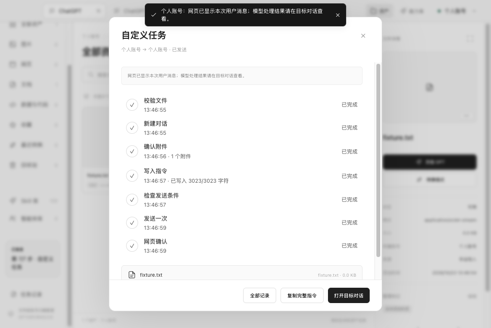

# ChatGPT Studio Desktop

项目已更名为 **ChatGPT Studio**；当前公开版本为 alpha.16，安装文件中的旧名称为升级兼容保留。内部包名、加密身份和数据目录保留以兼容升级。

当前公开预发布版：macOS / Windows `3.0.0-alpha.16`。提供 macOS Apple Silicon 的 DMG / ZIP、Windows x64 的 EXE / ZIP；历史安装包保留。Electron `44.9.1`、React `19.3.1`、TypeScript。各设备独立使用，本版不需要自建服务。

下载见[GitHub Release](https://github.com/ForceMind/ChatGPT/releases/tag/v3.0.0-alpha.16)。当前 `main` 包含工作台、恢复、新图标与跨平台源码。真正退出后需要重新加载网页并恢复保存状态；macOS alpha.12 先显示本地只读快照，具体范围见下文。

## macOS alpha.14 验证版：任务流与资产操作

[Actions 测试与安装包](https://github.com/ForceMind/ChatGPT/actions/runs/39963836108) · [精确摘要与验证范围](../docs/releases/3.0.0-alpha.14-ci.json)



本批安装包在 GitHub Actions 测试 / 构建，以 Actions 附件交付；这些能力已并入 alpha.16 公开包，历史 CI 验证索引保留。

- 「交给 GPT」显示七个实际进度点：校验文件、新建对话、确认附件、写入指令、检查发送条件、发送一次、网页确认。显示真实时间、失败位置与写入字符数；关闭面板后从侧栏任务入口返回。旧任务没有详细进度时明确标注，不补造历史时间。
- 富文本输入解析实际可编辑节点，重新聚焦并确认完整文本；最多三次写入，只补已核对前缀的缺失部分，保留不一致或人工修改的草稿。指令写入和按钮就绪使用不同失败提示。检测到网页确认前不会标为已发送；发送不确定时不自动重发，可打开目标对话并复制完整指令手动处理。
- 资产双击打开本地预览；右键提供预览、交给 GPT、重命名、复制文件名、另存为、Finder 定位和可逆回收站。批量选择限制单文件操作，右击其他文件会清除旧批量勾选。原件和账号权限沿用。
- CI 使用真实 ProseMirror 编辑器、实际本地附件和隔离账号，验证多行指令、重挂载、部分写入、拒绝输入、按钮延迟 / 不可用、人工改稿、一次发送 / 不确定处理与资产菜单。不是实际 ChatGPT 服务；个人账号页面结构仍需安装后实际验证。

## macOS alpha.13 恢复授权

- 首次安装 / 升级后先在可见窗口说明钥匙串用途，由用户选择继续恢复或先打开网页；同版本已授权时正常恢复。取消和失败不会删除 Cookie、账号分区、旧密钥或恢复原件。
- 账号菜单与文件菜单新增“隐私与本地恢复”，提供授权状态和重试。尚未授权时，本次草稿不写入磁盘；退出时会提醒。授权后仍保留网页已有草稿，本地版本按原有冲突规则保存。
- 后台更新重新打开后保持隐藏，不读取恢复密钥、不弹恢复验证；回到 App 后才恢复。Chromium 登录 Cookie 自身的系统加密授权由 Electron / macOS 管理，不能承诺取消应用恢复授权就绝不会出现其他系统钥匙串提示。
- Touch ID 路径使用原生 Security / LocalAuthentication 的 `kSecAccessControlUserPresence` 约束恢复密钥；旧系统密文仅加一层 AES-256-GCM 包装，不生成明文迁移副本。**当前没有 Developer ID 证书，临时签名包不允许启用该路径**，继续使用原系统加密。原生组件编译和受限路径、加密协议 / 中断恢复可隔离检查；真实签名密钥创建、Touch ID / 密码回退和跨签名升级尚未验收，不能宣称已交付可用指纹保护。
- 未配置稳定签名时，升级后的 macOS 钥匙串仍可能要求一次登录密码；本版不更换或绕过旧钥匙串权限。公开下载与自动更新清单已更新为 CI 构建的 alpha.13。

## macOS alpha.12

本批已公开发布 macOS DMG / ZIP；Windows / Android 公开版继续使用 alpha.11，尚未迁入本批更新。

- 退出后重新打开，先显示本机加密保存的上次可见画面与对话文字，再连接原网页并恢复草稿 / 阅读位置。快照为只读，带保存时间；图片保留在可见画面中，附件与网页操作需联网。对话最多 100,000 字符、300 条，超出时明确提示；登录页、验证码和临时聊天不采集。
- 启动时、每天上海时间中午 12:00 检查 `https://chatgpt.xincreates.com/updates/macos.json`。运行期间最多延迟 30 秒，休眠后补检；完全退出不会由系统自动启动。更新会话独立，不使用 ChatGPT 的 Cookie。
- 发现新版后先确认，可选 GitHub 原始下载或第三方 gh-proxy.org 加速。后台流式下载，核对完整大小、SHA-256、包内身份、架构与签名；不覆盖正在运行的 App。
- 下载完成后弹窗选择立即保存并重启安装，或下次真正退出时安装。弹窗可勾选应用空闲安装，账号菜单也可关闭：仅本 App 在后台且 30 分钟没有键鼠、切换或窗口操作时计时，其他软件的使用不重置；所有标签、文件任务和网页状态通过检查后显示 60 秒非激活倒计时。返回 App、点击取消、出现任务或状态不明都会延后。安装前再次校验并保存，完成后在后台重新打开，不抢其他软件焦点。休眠唤醒重新计算空闲时间。退出先保存恢复记录，原生安装器等待进程结束后原子替换，保留一份旧 App；也可从“检查更新”保存并重启。启动新版本后清理旧 ZIP 与更早的备份，不清理账号数据。
- Mac 需要先移入本机可写的应用目录；DMG、App Translocation、只读目录不进行自动替换。当前仍为 ad-hoc 签名，未经过 Apple 公证。完整 App 更新需要退出进程；本批下载完整 ZIP，增量和免重启更新未实现。alpha.11 本身没有这个更新入口，需要先手动安装本批版本。

官网保留 GitHub 原始链接，三平台均可展开“国内用户加速下载”；语言 / 时区只突出提示，不识别国籍、不自动跳转。第三方服务不可用时可换回原始链接，并使用页面摘要校验。

## 使用

```sh
npm ci
npm start
```

`npm ci` 的安装步骤准备官方 Electron 运行时。如果安装在网络中断时退出，恢复连接后执行 `npm run setup`。已构建后可直接执行 `npm run start:built`。

1. 首次打开直接进入 ChatGPT，默认建立“个人账号”空间。
2. 点击“添加账号”，填写名称、可选邮箱备注和颜色；在新空间的网页内登录另一个账号。
3. 通过右上角账号菜单切换其专属标签组；顶部持续显示当前账号名称，菜单中显示邮箱备注。界面没有地址栏和额外账号侧栏。
4. 标签支持新建、关闭、恢复、固定和拖动排序；右键标签或使用 macOS“标签页”菜单操作。关闭最后一个标签会保留一个首页标签。
5. 在账号管理中修改备注、调整账号顺序、清除该账号的本机登录数据或移除账号。清理和移除均有本机确认，并关闭该账号的标签和登录弹窗。

顶部保留窗口控制、标签页、拖动空白区和账号切换；macOS alpha.5 与 Windows alpha.6 提供资产与能力库入口。刷新、前进后退、首页、外部打开和原生全屏位于系统菜单及快捷键中。原生全屏的窗口移动遵循 macOS 行为，退出全屏后可移动。

账号名称与邮箱是手动备注，真实身份以网页内账号菜单为准。本程序不收集或保存密码；登录 Cookie 由浏览器保存。

## 桌面界面恢复

- macOS 点击红色关闭按钮或“关闭窗口”会隐藏窗口并留在后台。点击 Dock 图标重新显示同一窗口；切换账号或已打开标签保持原网页实例。
- Windows alpha.6 关闭窗口会先保存界面与加密草稿，再真正退出；重新启动时网页加载一次并恢复。切换已打开的账号和标签保留同一网页实例，不自动冻结。
- 撤销关闭优先复用原网页，保留位置与固定状态。最近 5 个普通页面关闭后保留 10 分钟；登录表单和临时聊天不加入关闭页缓存；超出后从恢复记录重新加载，已打开标签不受此缓存限制。
- 每个账号分别保存工作台面板、搜索/筛选、排序、视图、选中文件和预览入口。
- macOS 用 `⌘Q` 真正退出，Windows 关闭窗口或选择退出。重启会加载网页一次，再恢复聊天草稿和消息阅读位置；先恢复当前页，再顺序恢复上次已加载的标签。网页已有草稿时保留网页版本，可从“文件 → 查看本地恢复草稿”复制本地版本。
- 聊天草稿和阅读记录通过 Electron 的系统加密保存，macOS 使用钥匙串，Windows 使用系统保护，存于应用数据目录的 `recovery/`。登录表单、验证码和附件不保存；临时聊天不加入恢复记录。加密不可用时提示，不能退回明文。清除/移除账号同时清除对应恢复资料。
- “文件 → 搜索 ChatGPT”与 `⌘K` 提供网页搜索入口，关闭客户端菜单后归还网页焦点。网页内容的窗口拖动样式被禁用，仅由应用自己的顶部空白区提供拖动，避免吞掉网页按钮的鼠标事件。
- 界面恢复不自动发送、重传附件或重放登录跳转。真实退出、系统休眠或进程回收不能保留原网页运行内存。

## 桌面工作台

`alpha.4` 同时加入以下使用体验：

- 已打开标签保持页面实例，切换或隐藏窗口不主动冻结、丢弃或重载。明确关闭、退出及操作系统回收仍会中断网页任务。
- 创建或编辑账号时可选浏览器语言、IANA 时区；编辑从新标签起生效，已有页面和登录窗口沿用原设置。
- ChatGPT 网页图片可右键复制原始像素、保存到当前账号资产库、重试当前图片并查看加载信息。跨域计时可能不公开，无法承诺缩短网站后端出图时间。


启动仍直接打开 ChatGPT，使用已确认的白灰黑界面、无地址栏。点击顶部「资产」管理当前账号的文件；alpha.5 已提供公开预发布安装包，网页集成仍需真实 ChatGPT 账号验收。

- 下载归档：当前账号的网页下载直接进入资产库，保存来源标签/对话、大小和 SHA-256。通过「导入」或拖入本机文件添加已有素材，导入保留原文件。
- 整理与预览：按类别/名称查找，网格或列表查看；支持重命名、标签、收藏、可恢复回收站、Finder 定位、另存为。图片、HTML、PDF、Markdown、文本、CSV 可在 App 内预览。HTML 脚本在独立沙箱运行，不能访问账号存储、管理接口或外部网络；依赖在线 CDN 的网页可能缺少资源。
- 能力库：120 个项目任务 Skill，包含完整步骤、交付结构、检查与示例。智能体库界面保留，当前没有预置角色。
- 本地转换：PNG/JPEG/WebP、SVG→图片、HTML→PDF/PNG、Markdown→HTML/PDF、CSV↔JSON、PDF 选页→图片。转换生成原账号的新副本，保留原件和派生关系；部分格式有宽度、质量与页码选项。CSV 保留文本值，JSON→CSV 转义公式前缀。
- 交给 GPT：选中文件，选择目标账号、Skill、可选角色与要求，点击「新建对话并发送」。跨账号带文件需要明确勾选确认；本版最多 20 个文件，单文件 100 MB、合计 200 MB。HTML/SVG/代码使用 `.txt` 附件名保留内容，界面展示名称映射。通过正常网页上传和发送，不使用私有接口，也无需 API Key。
- 任务记录：来源与目标账号固定，等待网页确认附件后才填入要求、发送一次。已发送表示网页出现本次用户消息，不代表模型已完成；模型产物仍在对应对话下载。发送结果不确定或应用中断后不会自动重试，可打开目标对话检查。

「账号菜单 → 登录与链接记录」显示本机最近 200 条登录站点与被拦截链接的站点、来源、时间、账号和原因。可筛选、复制脱敏记录、清空；不保存 URL 路径、查询、片段或回调验证码。外链拦截不一定代表登录失败，以网页实际登录状态为准。

登录帮助说明 Apple「密码」与 Chrome / Google Password Manager 的区别。本版尚未接入已有系统通行密钥选择器，也不会继承 Chrome 保存的密钥或登录状态。网页提供其他方式时，可选择密码、验证码或相应设备方式；真实通行密钥流程仍待验证。现有正常登录行为保留。

## 快捷键

| 操作 | 快捷键 |
|---|---|
| 新建标签 | `⌘T` |
| 关闭标签 | `⌘W` |
| 恢复关闭标签 | `⌘⇧T` |
| 添加账号 | `⌘⇧N` |
| 切换标签 | `⌃Tab` / `⌃⇧Tab` |
| 第 1–8 个 / 最后一个标签 | `⌘1`–`⌘8` / `⌘9` |
| 重新加载 | `⌘R` |
| 打开/关闭账号菜单 | `⌘B` |
| 后退 / 前进 | `⌘[` / `⌘]` |
| 进入/退出全屏 | `⌃⌘F` |

## 数据和恢复

- 开发版：项目内 `.local-data/`。
- Mac 安装版：`~/Library/Application Support/ChatGPT Profiles/`。
- Windows 安装版及 ZIP：`%APPDATA%\ChatGPT Profiles\`。免安装 ZIP 仍使用该数据目录，不把登录数据写入程序文件夹。
- `state.json`：账号备注、标签、窗口位置；`state.backup.json`：上一个有效状态。
- `assets/library.json`、`assets/files/<账号 UUID>/`：资产索引和实际文件；`handoff/jobs.json`：任务记录；`login-links.json`：脱敏链接记录。请在 App 关闭后备份整个数据目录，避免只保留索引却丢失文件。
- `Partitions/profile-<UUID>/`：每账号独立持久浏览器数据。
- 损坏主状态文件时，从有效备份恢复并保留损坏原件；主文件与备份均损坏时停止启动，避免静默清空账号。
- 清除/移除账号会停止其下载、转换与网页任务，但保留本机已归档资产。移除后的文件仍在数据目录，当前没有归档账号恢复入口；移除前可先另存为。
- 清除本机登录数据不会删除 ChatGPT 云端对话，也不等同于撤销服务器端所有登录会话。
- 旧版与新版浏览器内核不同，首版按重新登录设计，不读取旧版 Cookie。

账号登录弹窗使用发起账号的同一 session。网页采用沙箱和上下文隔离，没有 Node 或本地控制 IPC。系统浏览器打开的链接使用系统浏览器自身的账号状态。摄像头、麦克风、通知和剪贴板读取按来源请求本机许可。

账号菜单或编辑框打开时，使用仅保留于内存的网页画面作为背景，避免原生网页视图遮住本地菜单；关闭即清除，不写入状态文件或上传。

## 验证和构建

```sh
npm run check
npm run test:e2e
```

- 单元测试覆盖状态持久化、损坏恢复、账号归属和导航策略。
- Electron 验收仅使用本机回环网页、临时数据目录，页面明确标记“非 ChatGPT”。测试不会操作真实账号或发送模型消息。
- 维护发布统一使用 `.github/workflows/macos-release.yml`：固定已推送源码与同版本 Release 草稿，在 GitHub Actions 构建、验证并直接上传 DMG / ZIP；仅将小型校验索引读回本机。后续发布不在本机打包或保留二进制缓存。Developer ID 签名、公证和 Intel Mac 实机验收仍需外部条件。
- 渲染截图与测试报告保存于 `test-results/`、`playwright-report/`，不纳入 Git。
- 独立完整验收使用 `.github/workflows/macos-validation.yml`，可分别运行所有 macOS 适用场景与同机版本资源对照 / 330 秒后台保活，不打包或发布、不使用个人账号。alpha.14 的[逐项回归结果](../docs/benchmarks/macos-alpha14-regression-20261024.json)与[资源报告](../docs/benchmarks/macos-alpha14-resources-20261024.json)已归档；资源数据来自本地模拟页面，不能作为实际 ChatGPT 占用上限。
- 原生拖动的开发诊断未取得自动化通过证据；用户已在最终 App 中用真实鼠标确认普通窗口顶部空白区可以正常拖动，此项人工验收通过。

完整验证记录和未验证项见仓库根目录 `MACOS_MIGRATION_PLAN.md`。实际 ChatGPT 登录、第三方登录提供商、语音及真实文件上传下载必须分别实测，不能从本地隔离测试推定通过。

## 开发资料

Windows alpha.6 的工作台、格式转换、登录记录、图片菜单、账号语言/时区与恢复，使用和 Mac 相同的本地实现与账号校验；Windows 仍使用原生窗口按钮、Ctrl 快捷键和 F11。Windows 加密使用 Electron 提供的系统加密，失败时明确报错，不保存明文草稿。

应用图标由本项目 SVG 绘制。macOS 通过系统 iconutil 编码完整的标准与 Retina 图标资源；不手工拼接 ICNS。

- Electron 会话分区：https://www.electronjs.org/docs/latest/api/session
- Electron 安全建议：https://www.electronjs.org/docs/latest/tutorial/security

本轮依赖审计：生产依赖 0 个已报告漏洞；打包工具 `electron-builder` 的间接依赖链报告 8 个 moderate 告警，根项为 `sprintf-js` 格式化拒绝服务问题。打包工具不随 App 分发；未使用强制降级或放宽检查掩盖告警。

## Windows 构建与使用

目标为 Windows x64；Windows ARM64 暂不原生打包。顶部使用 Windows 原生窗口按钮，账号菜单为按钮区域留空，不显示地址栏。`Ctrl+T/W/Shift+T` 分别新建、关闭、恢复标签；`Ctrl+Shift+N` 添加账号，`Ctrl+B` 切换菜单，`F11` 全屏。按 `Alt` 可临时显示系统菜单。

在 Windows x64、Node 26 环境执行：

```sh
npm ci
npm run dist:win
```

输出在 `release/windows/`，含 EXE 安装包、ZIP、`windows-build-info.json` 与 `SHA256SUMS.txt`。安装包默认按当前用户安装，不要求管理员权限；ZIP 解压后运行 `ChatGPT Profiles.exe`。退出应用后可更新程序文件，保留账号数据目录。卸载默认保留账号数据；在应用内清除账号才会清除相应登录。

当前未配置 Authenticode 证书，试用包未签名，SmartScreen 或组织策略可能拦截；请核对来源与摘要。CI 隔离验收使用本地 fixture，安装包启动只打开未登录网页；这些结果不代表 Windows 10/11 客户端真机与真实 ChatGPT 登录已经通过。最新检查及安装包入口见根目录进度记录。

alpha.6 的 [Windows 构建与安装验收](https://github.com/ForceMind/ChatGPT/actions/runs/39720554528) 针对源码 `4107ce4`：43 项单元、12 项原生流程、首次脚本与登录弹窗偏好、3 账号 / 8 标签隐藏约 330 秒的同实例保活、EXE / ZIP、安装启动、正常退出及卸载保留数据均通过。截图使用本地素材或未登录网页，未验证真实账号登录、发送和语音。

上述为历史验收记录；本地构建缓存已清理。当前 Windows 公开包及摘要见 [alpha.11 Release](https://github.com/ForceMind/ChatGPT/releases/tag/v3.0.0-alpha.11)，历史附件保留。
